# ToyShop Backend - Architecture Documentation

> Microservices-based e-commerce platform built with Spring Boot, Spring Cloud, and event-driven architecture.

---

## Table of Contents

1. [System Overview](#system-overview)
2. [High-Level Design (HLD)](#high-level-design)
3. [Architecture Diagram](#architecture-diagram)
4. [Service Interaction Flow](#service-interaction-flow)
5. [Data Architecture](#data-architecture)
6. [Event-Driven Architecture](#event-driven-architecture)
7. [Security Architecture](#security-architecture)
8. [Infrastructure Diagram (Local)](#infrastructure-diagram-local)
9. [Infrastructure Diagram (Cloud / Production)](#infrastructure-diagram-cloud--production)
10. [Deployment Architecture (Kubernetes)](#deployment-architecture-kubernetes)
11. [Technology Stack](#technology-stack)

---

## System Overview

ToyShop is a cloud-native e-commerce backend built as a suite of independently deployable microservices. Each service owns its domain, its database, and communicates either synchronously via REST (through the API Gateway) or asynchronously via Kafka events.

```
Client (React SPA)
      │
      ▼
API Gateway  ──►  Service Discovery (Eureka)
      │
      ├──► User Service      (auth, JWT, profiles)
      ├──► Product Service   (catalog, inventory, images)
      ├──► Order Service     (cart, orders, fulfillment)
      └──► Payment Service   (transactions, refunds)
                                    │
                              Kafka Events
                                    │
                             Notification Service
                             (email, push alerts)
```

---

## High-Level Design

### HLD - Component View

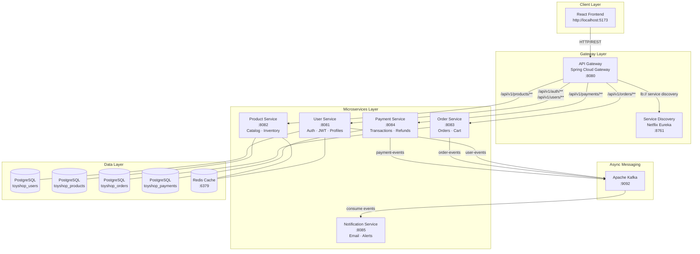

---

## Architecture Diagram

### Detailed Service Architecture

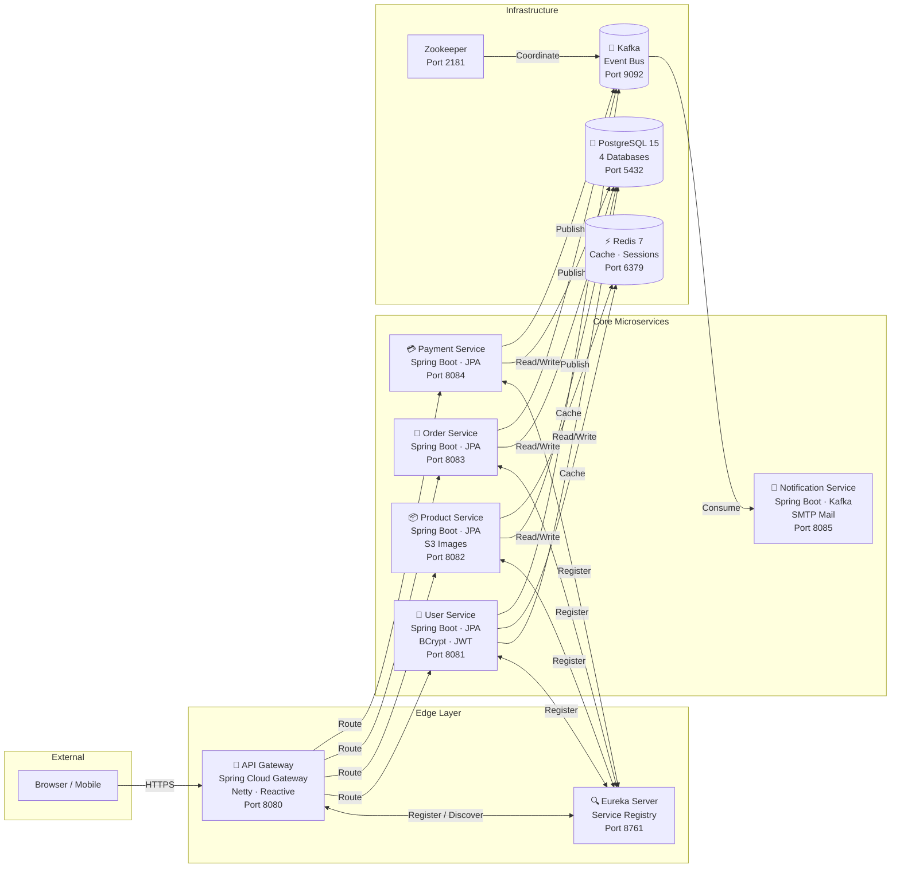

---

## Service Interaction Flow

### User Login Flow

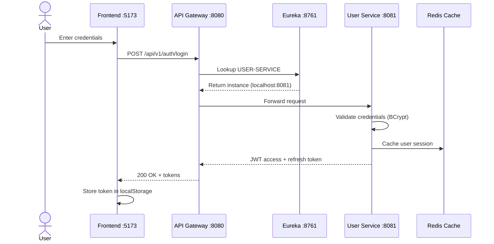

### Place Order Flow

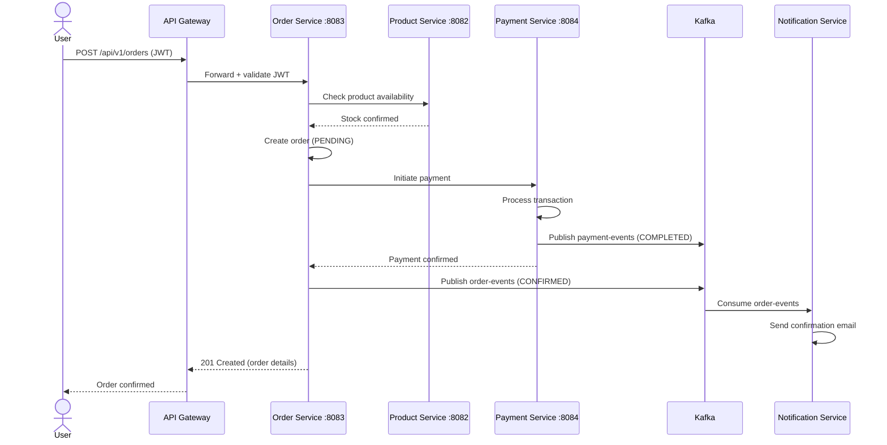

---

## Data Architecture

### Database-per-Service Pattern

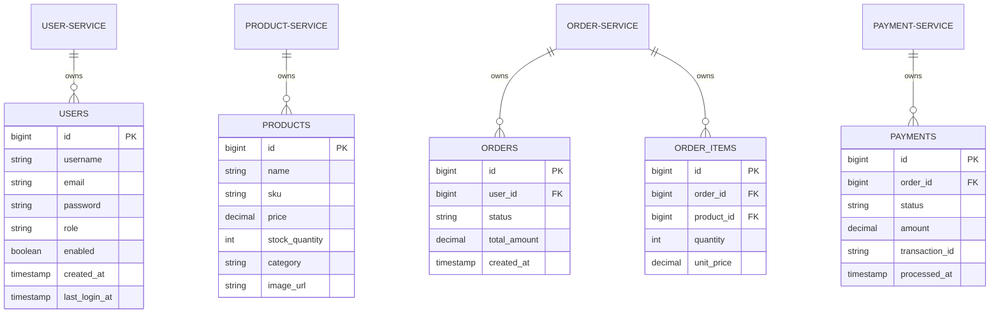

### Caching Strategy

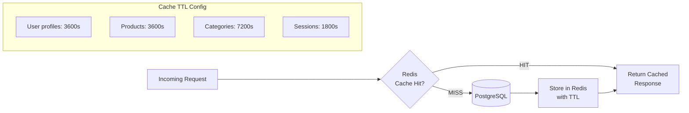

---

## Event-Driven Architecture

### Kafka Topics & Consumers

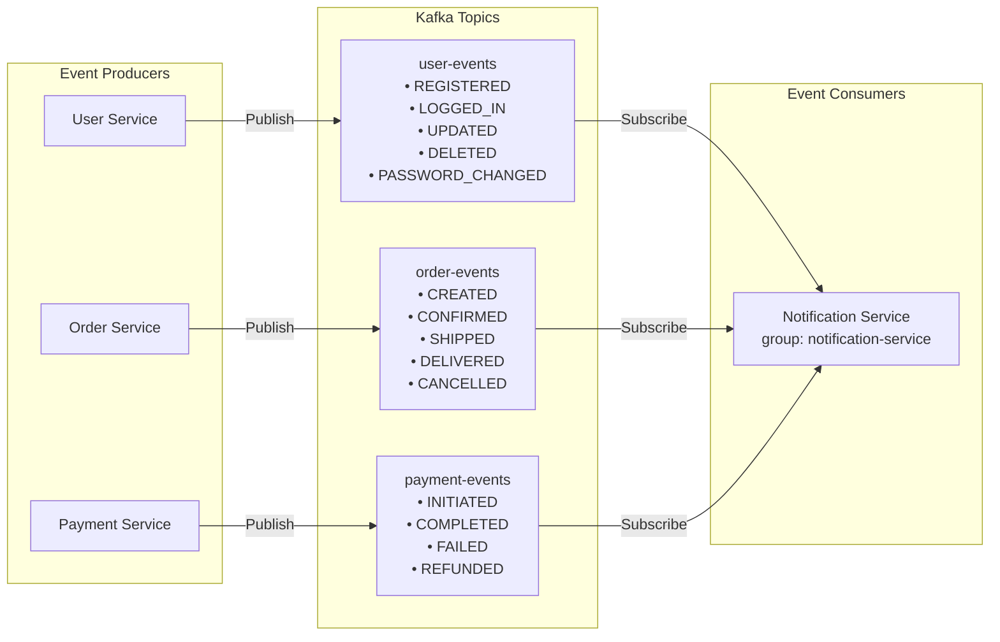

---

## Security Architecture

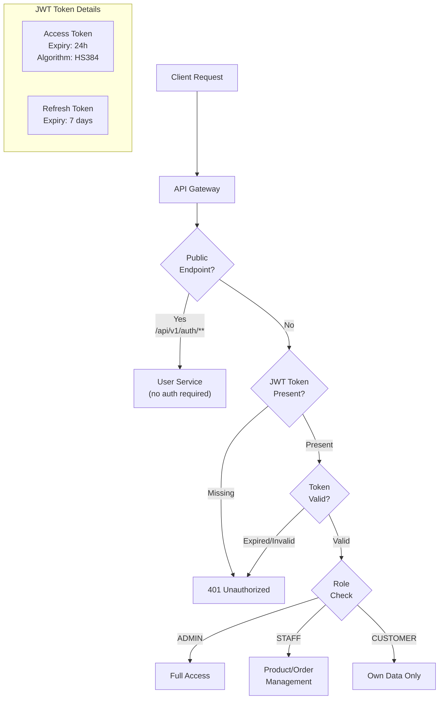

---

## Infrastructure Diagram (Local)

### Local Development Stack

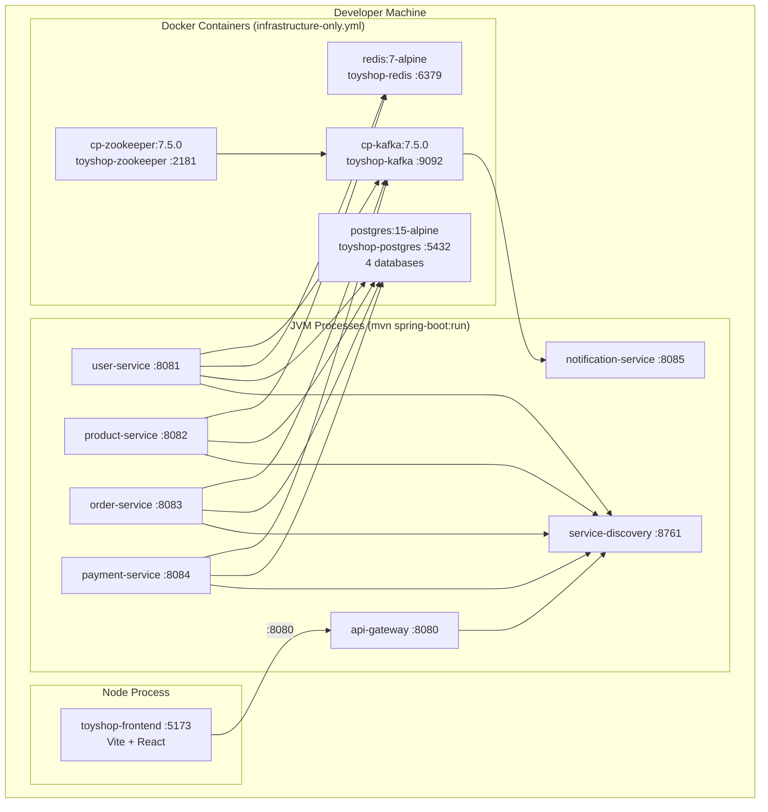

---

## Infrastructure Diagram (Cloud / Production)

### AWS Production Architecture

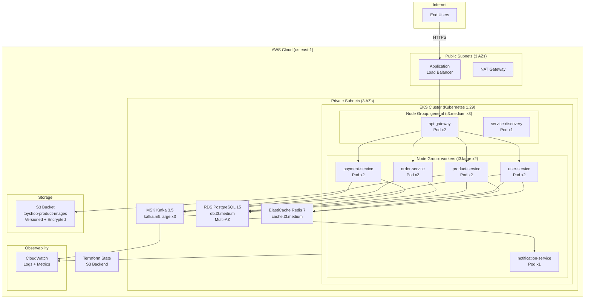

---

## Deployment Architecture (Kubernetes)

### K8s Resource Layout

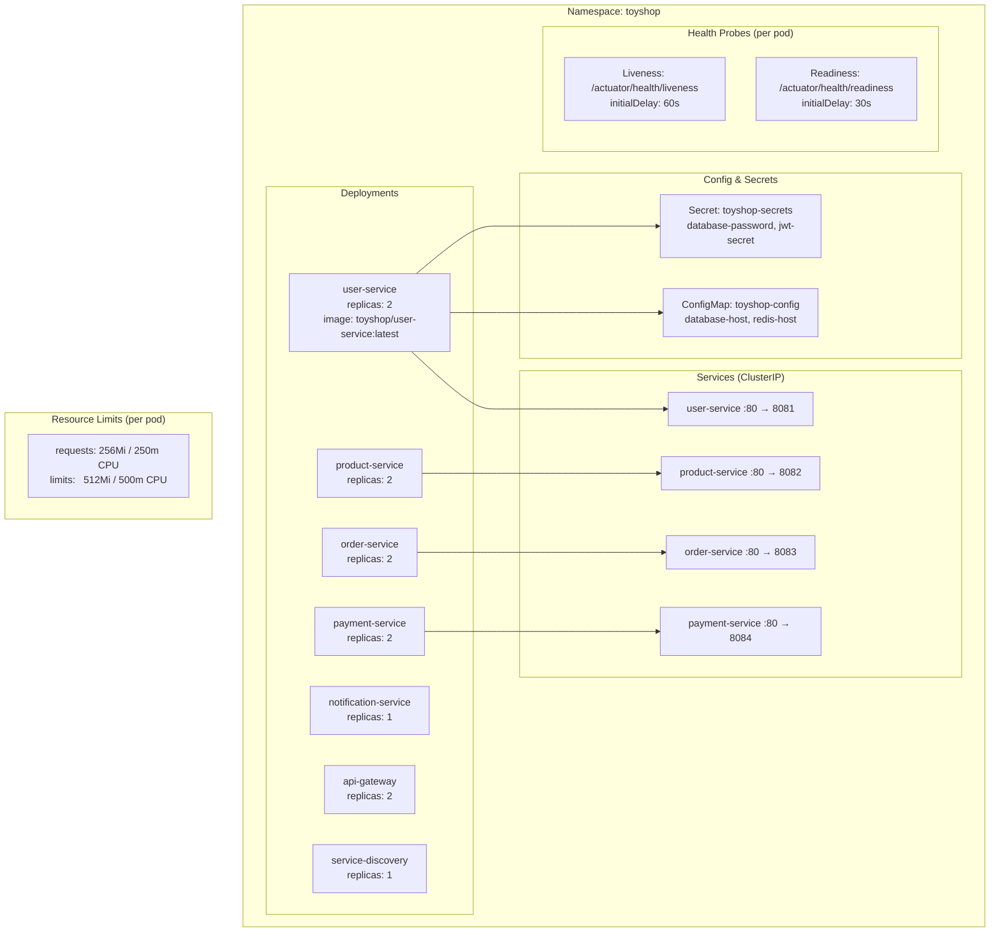

---

## Technology Stack

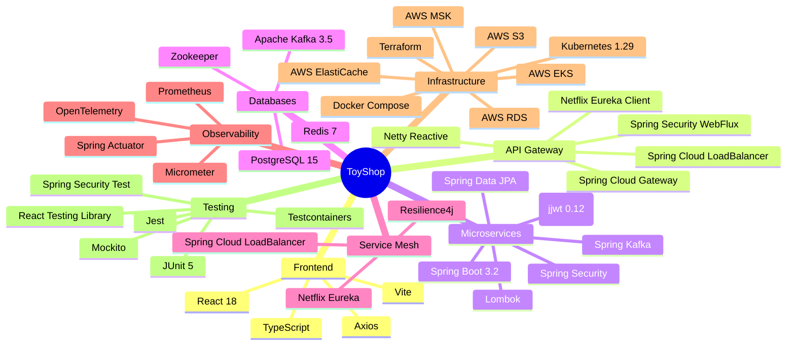

---

## Port Reference

| Service | Port | Protocol | Notes |
|---------|------|----------|-------|
| API Gateway | 8080 | HTTP/Reactive | Main entry point for all clients |
| User Service | 8081 | HTTP/Servlet | Auth, JWT issuance |
| Product Service | 8082 | HTTP/Servlet | Catalog, S3 image upload |
| Order Service | 8083 | HTTP/Servlet | Order lifecycle |
| Payment Service | 8084 | HTTP/Servlet | Transactions |
| Notification Service | 8085 | HTTP/Servlet | Email via SMTP |
| Eureka Dashboard | 8761 | HTTP | Service registry UI |
| PostgreSQL | 5432 | TCP | 4 separate databases |
| Redis | 6379 | TCP | Cache + sessions |
| Kafka | 9092 | TCP | Event streaming |
| Zookeeper | 2181 | TCP | Kafka coordination |
| Frontend (dev) | 5173 | HTTP | Vite dev server |
